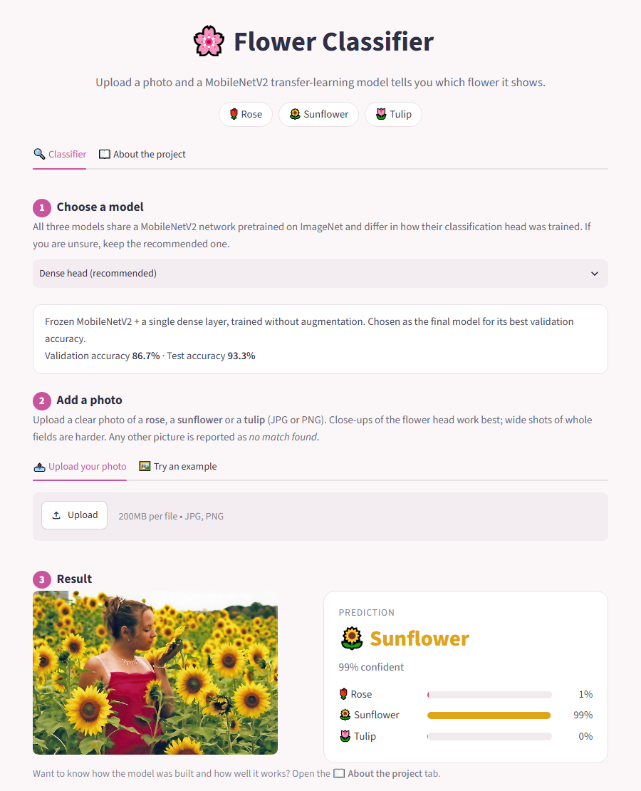
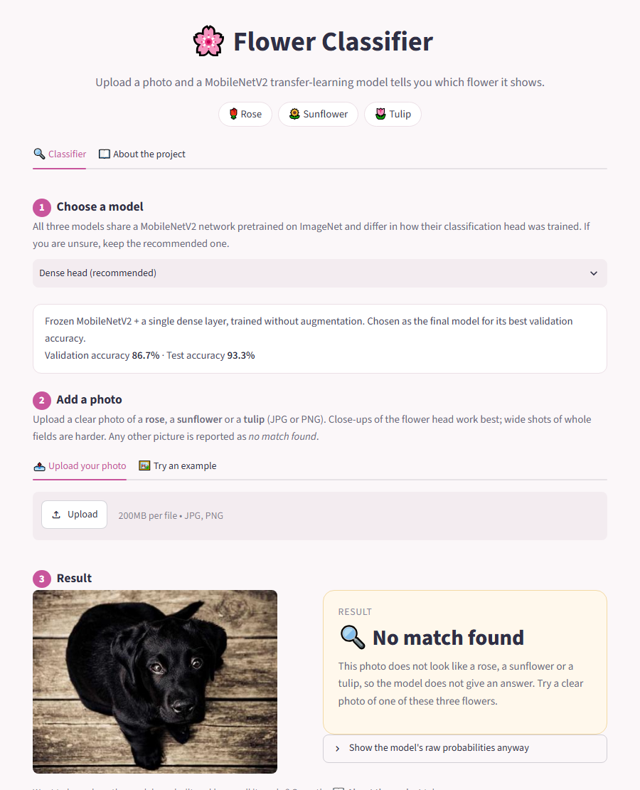
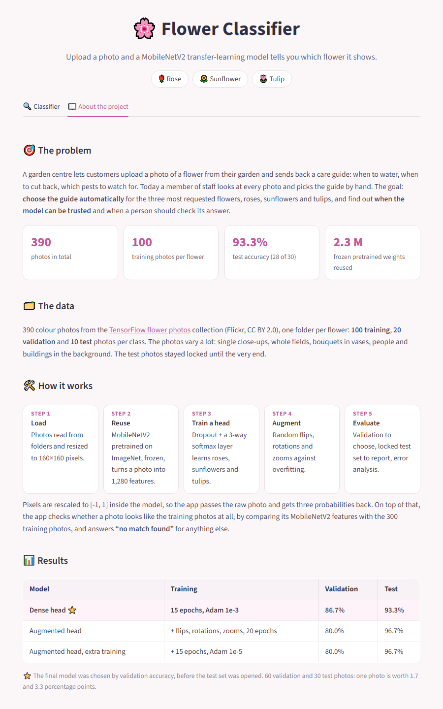

# 🌸 Flower Classifier: Transfer Learning with MobileNetV2

Classifying photos of **roses, sunflowers and tulips** with only **100 training photos per flower**, by reusing a MobileNetV2 network pretrained on ImageNet. The final model, chosen by validation accuracy, gets **93.3% accuracy (28 of 30)** on a held-out test set. It runs in a Streamlit web app that also says **"no match found"** for photos that are not one of the three flowers.

[](https://nicolai-flowers.streamlit.app/)


**▶ Try it: [nicolai-flowers.streamlit.app](https://nicolai-flowers.streamlit.app/)**

| Prediction | Not a flower | About the project |
| :--: | :--: | :--: |
|  |  |  |

## The Problem

A garden centre lets customers upload a photo of a flower from their garden and sends back a care guide. Today a member of staff looks at every photo and picks the guide by hand. The goal is to **choose the guide automatically** for the three most requested flowers, and to find out **when the model can be trusted** and when a person should check its answer.

## Data

390 colour photos from the [TensorFlow flower photos](https://www.tensorflow.org/datasets/catalog/tf_flowers) collection (Flickr, CC BY 2.0), stored in [`data/`](data/) with one folder per flower:

| Split | Rose | Sunflower | Tulip | Used for |
| :-- | --: | --: | --: | :-- |
| `train` | 100 | 100 | 100 | training |
| `validation` | 20 | 20 | 20 | choosing the model |
| `test` | 10 | 10 | 10 | final evaluation only, kept locked until the end |

The photos are very diverse: single close-ups, whole fields, bouquets in vases, people and buildings in the background. They range from 159 to 640 pixels wide.

## Approach

```
photo (160×160×3, pixels 0-255)
  → [RandomFlip, RandomRotation(0.1), RandomZoom(0.1)]   only during training, augmented models
  → Rescaling to [-1, 1]                                 = mobilenet_v2.preprocess_input
  → MobileNetV2, ImageNet weights, frozen, average pooling → 1,280 features
  → Dropout(0.2)
  → Dense(3, softmax)                                     rose / sunflower / tulip
```

1. **Load** the photos with `keras.utils.image_dataset_from_directory` at 160×160 pixels.
2. **Explore** the training set: sunflowers stand out by colour and shape; roses and tulips come in many colours and differ mostly by shape.
3. **Transfer learning:** freeze the pretrained MobileNetV2 (2.3 M weights) and train only the small head (3,843 weights).
4. **Data augmentation** against overfitting.
5. **Evaluate** all saved models on the locked test set, with a confusion matrix and a look at every misclassified photo.
6. **Deploy** the models in a Streamlit app on Streamlit Community Cloud.

The full analysis is in [`01_flower_classification_project.ipynb`](01_flower_classification_project.ipynb).

## Results

| Model | Training | Validation accuracy | Test accuracy |
| :-- | :-- | --: | --: |
| **Dense head** ⭐ | 15 epochs, Adam 1e-3 | **86.7%** | **93.3%** |
| Augmented head | + flips, rotations, zooms, 20 epochs | 80.0% | 96.7% |
| Augmented head, extra training | + 15 epochs, Adam 1e-5 | 80.0% | 96.7% |

⭐ **The final model was chosen by validation accuracy**, before the test set was opened. Its test accuracy, **93.3%**, is the honest estimate for new photos. The augmented models score one photo higher on the test set, but choosing them for that would use the test set for model selection and make the reported number optimistic. With 60 validation and 30 test photos, one photo is worth 1.7 and 3.3 percentage points.

### Key Findings

- **Transfer learning works with very little data.** With only 300 training photos, a frozen MobileNetV2 and one dense layer classify 28 of 30 unseen test photos correctly.
- **Choose by validation, report the test.** A one-photo difference on 30 test photos is random variation, not a better model.
- **The dense head overfits.** It reaches about 99-100% training accuracy against 87% validation accuracy. Data augmentation did not raise the validation accuracy here (80.0%).
- **Both test mistakes are sunflowers:** a wide shot of a garden where the sunflowers are small and far away (predicted rose, 72%), and sunflowers in vases next to other flowers, some of them dark red (predicted tulip, 79%). **Close-ups of one kind of flower work best.**
- **Mistakes come with lower confidence.** On the validation and test photos, answers below 80% confidence include 6 of the 10 mistakes but only 7 of the 80 correct answers (9%). For the garden centre, these answers are worth a staff check.
- **A 3-class model always answers.** It called a photo of a forest by the sea a sunflower with 95% confidence. That is why the app adds an out-of-scope check (below).
- **About model 3:** the fine-tuning step unfroze the `augmentation` block instead of MobileNetV2, so the base stayed frozen. Model 3 is the augmented model trained for 15 more epochs at a lower learning rate.

## The App: "No Match Found"

A softmax over three classes always picks one of them, even for a photo of a car. The app therefore answers **"no match found"** when either:

1. **The photo does not look like the training photos.** The app compares the photo's MobileNetV2 features with the features of all 300 training photos. If the mean cosine similarity to the 5 most similar ones is below **0.44**, the photo is out of scope.
2. **The model is not confident.** Its top probability is below **60%**.

The thresholds were calibrated on the validation and test photos and on about 40 extra photos of other objects and other flowers. Results with the Dense head:

| Photos | Answered "no match found" |
| :-- | --: |
| Objects, animals, landscapes, food, buildings | 100% |
| Other flowers (lily, orchid, lotus, lavender, dandelion…) | about 40% |
| Real roses, sunflowers and tulips (validation + test) | 7% |

**Limitation:** flowers that look a lot like the three classes, such as peonies (like roses) or daisies (like small sunflowers), can still be classified as one of them.

## Run It Locally

You need [uv](https://docs.astral.sh/uv/).

```bash
git clone https://github.com/NicolaiTurcan/amle-project-flowers.git
cd amle-project-flowers
uv sync                        # installs TensorFlow, Keras, Streamlit and the rest into .venv/
uv run streamlit run app.py    # opens the app in your browser
```

To reproduce the training, open the notebook in VS Code or Jupyter with the `.venv` environment as the kernel. The pretrained MobileNetV2 weights (9 MB) are downloaded on first use.

## Project Structure

| Path | Description |
| :-- | :-- |
| [`01_flower_classification_project.ipynb`](01_flower_classification_project.ipynb) | Data exploration, training, evaluation and error analysis |
| [`app.py`](app.py) | Streamlit app: classifier with the "no match" check and an "About the project" tab |
| [`models/`](models/) | The three trained models (`.keras`, about 10 MB each) |
| [`data/`](data/) | The 390 photos, with their photographers in `data/LICENSE.txt` |
| [`assets/`](assets/) | Project workflow diagram, app screenshots and the example photo |
| [`.streamlit/config.toml`](.streamlit/config.toml) | App theme |
| [`pyproject.toml`](pyproject.toml), [`uv.lock`](uv.lock) | Dependencies |

## Tech Stack

Python 3.13 · TensorFlow / Keras 3 · MobileNetV2 · scikit-learn · pandas · NumPy · Matplotlib · Streamlit · Streamlit Community Cloud · uv

## Next Steps

- Fine-tune the top layers of MobileNetV2 with a low learning rate. The pretrained base stayed frozen in this project.
- Collect more photos, especially wide shots, and use cross-validation for more reliable accuracy estimates.
- Add more flowers and an explicit *other* class to handle out-of-scope photos better.

## Credits

- Built as a team project during an ML engineering course.
- **Flower photos:** [TensorFlow flower photos](https://www.tensorflow.org/datasets/catalog/tf_flowers), licensed under [CC BY 2.0](https://creativecommons.org/licenses/by/2.0/). Every photographer is listed in [`data/LICENSE.txt`](data/LICENSE.txt).
- **Dog photo** in the app's examples: André Spieker on [Unsplash](https://unsplash.com/photos/8wTPqxlnKM4) (Unsplash License).
- **MobileNetV2:** Sandler et al. (2018), [*MobileNetV2: Inverted Residuals and Linear Bottlenecks*](https://arxiv.org/abs/1801.04381).
